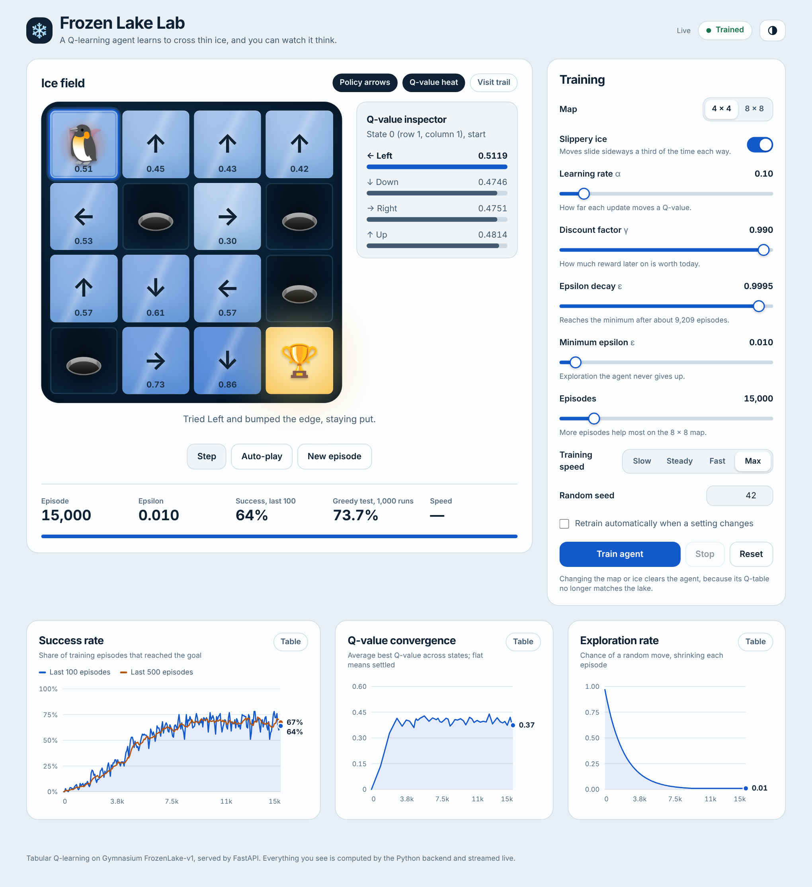
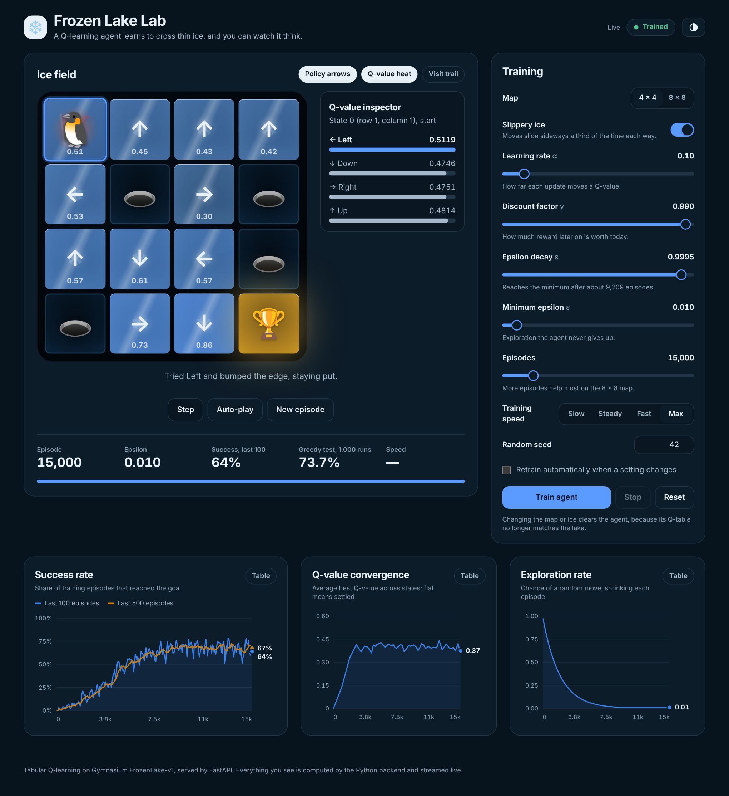
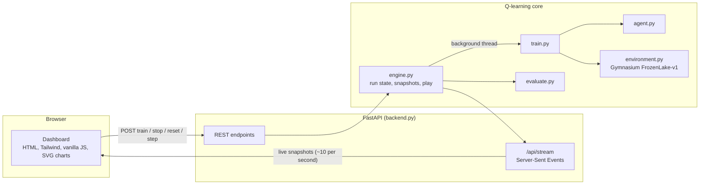

<div align="center">

# ❄️ Frozen Lake Lab

**Watch a Q-learning agent learn to cross thin ice, live in your browser.**

Tune the hyperparameters, retrain on demand, and inspect every Q-value as the policy emerges.




</div>

## What it is

A tabular Q-learning agent (NumPy, Gymnasium) wrapped in a full-stack web app. The Python backend trains the agent and streams every update to a dashboard that shows what the agent knows and how it got there.

- **Live ice field.** A penguin slides across the lake. During training it replays its latest attempt; afterwards you can step it, auto-play it, or steer it with the arrow keys. Slips, splashes and wins are animated.
- **Overlays.** Policy arrows, a Q-value heat layer and a visit trail show where the agent is confident and where it has been.
- **Hyperparameter controls.** Learning rate, discount factor, epsilon decay, minimum epsilon, episode count, slippery ice, 4 × 4 or 8 × 8 map, training speed and seed. Optionally retrain automatically on every change.
- **Live charts.** Moving-average success rate (100 and 500 episodes), Q-value convergence and epsilon decay, each with a hover tooltip and a table view.
- **Q-value inspector.** Click any tile to see its four action values.

| Dark mode | |
|---|---|
|  | The theme follows your system setting, with a manual toggle. |

## Quick start

```bash
git clone <your-repo-url> frozenlake-qlearning
cd frozenlake-qlearning

python -m venv venv
source venv/bin/activate          # Windows: venv\Scripts\activate
pip install -r requirements.txt

uvicorn backend:app --reload
```

Open **http://localhost:8000**, press **Train agent**, then press **Auto-play**.

The original command-line pipeline still works and writes the three Matplotlib plots to `results/plots/`:

```bash
python main.py
```

## Architecture



**Why this shape**

- `engine.py` has no web dependencies. It owns one training run, executes the *unchanged* `train()` loop in a background thread through two small hooks, and publishes JSON snapshots. It can be tested, or reused from a notebook, without a server.
- `backend.py` is only routing and validation.
- Live updates use **Server-Sent Events**, so there is no WebSocket library to install, and the browser reconnects on its own.
- Charts are hand-written SVG, so the frontend needs no JavaScript dependencies and works offline.

### Project structure

```
backend.py          FastAPI app: routes, validation, static frontend
engine.py           Training runs, snapshots, step-by-step play (framework-free)
sessions.py         One private agent per visitor, capacity limits, idle cleanup
config.py           Default hyperparameters and settings
environment.py      Builds FrozenLake-v1 (map and slipperiness are parameters)
agent.py            QLearningAgent: Q-table, epsilon-greedy, update rule
train.py            Training loop with on_episode_end and should_stop hooks
evaluate.py         Greedy evaluation (never touches the Q-table)
utils.py            Seeding, save and load helpers
visualize.py        Matplotlib plots for the CLI pipeline
main.py             Original end-to-end CLI pipeline
frontend/
  index.html        Dashboard markup
  static/app.js     Stream client, board, controls, charts
  static/app.css    Compiled Tailwind (committed)
  src/input.css     Tailwind source and design tokens
tests/              pytest suite
scripts/build_css.mjs   Offline Tailwind build
Dockerfile, render.yaml, requirements-server.txt   Deployment
```

## API

| Method | Path | Purpose |
|---|---|---|
| `GET` | `/api/config` | Defaults and available maps |
| `GET` | `/api/state` | Latest snapshot as JSON |
| `GET` | `/api/stream` | Live snapshots (Server-Sent Events) |
| `POST` | `/api/train` | Start or restart training with hyperparameters |
| `POST` | `/api/stop` | Stop the running job |
| `POST` | `/api/reset` | Discard the run and show a fresh agent |
| `POST` | `/api/play/reset` | Start a new greedy episode |
| `POST` | `/api/play/step` | Advance one step; optional `{"action": 0-3}` overrides the greedy move |
| `POST` | `/api/evaluate` | Greedy evaluation of the current Q-table |

Interactive docs are generated at **/docs**. A snapshot carries the Q-table, greedy policy, visit counts, epsilon, downsampled metric series, the latest training path and the evaluation result.

```bash
curl -X POST localhost:8000/api/train -H 'content-type: application/json' \
     -d '{"alpha": 0.1, "gamma": 0.99, "epsilon_decay": 0.9995, "episodes": 15000, "slippery": true}'
```

## The algorithm

Standard tabular Q-learning with an epsilon-greedy policy:

```
Q(s, a) ← Q(s, a) + α · [ r + γ · max Q(s′, a′) − Q(s, a) ]
```

Terminal transitions do not bootstrap, because there is no next action beyond the goal or a hole. On the default slippery 4 × 4 map the greedy policy reaches the goal in roughly 70 to 75 percent of runs, close to the best achievable on that map. Slippery 8 × 8 needs far more episodes (the UI suggests 30,000) and is a good place to experiment with decay and learning rate.

## Deploy

Each visitor gets a private agent through a session cookie, so the app is safe to publish. Run **one worker process**, because sessions live in memory.

**Render (free, no credit card needed for the free tier)**

1. Push this folder to a GitHub repository.
2. On [render.com](https://render.com), choose **New → Blueprint**, pick the repository and approve. `render.yaml` configures everything.
   (Or **New → Web Service** with build command `pip install -r requirements-server.txt` and start command
   `uvicorn backend:app --host 0.0.0.0 --port $PORT --workers 1 --proxy-headers --forwarded-allow-ips="*"`.)
3. When the deploy finishes, open the `https://<name>.onrender.com` URL.

Free services sleep after 15 minutes without traffic and take about a minute to wake up.

**Docker (Fly.io, Railway, Hugging Face Spaces, any VPS)**

```bash
docker build -t frozen-lake-lab .
docker run -p 8000:8000 frozen-lake-lab
```

**Tuning limits** with environment variables: `FLL_MAX_SESSIONS` (default 100), `FLL_MAX_TRAINING` concurrent training jobs (default 3) and `FLL_SESSION_TTL` idle seconds (default 1800). Health check: `GET /healthz`.

## Development

```bash
pip install -r requirements-dev.txt
pytest
```

The frontend ships with its compiled stylesheet. After editing classes in `index.html` or `app.js`, rebuild it:

```bash
npx @tailwindcss/cli -i frontend/src/input.css -o frontend/static/app.css --minify
```

## Changes to the original code

All additions are backward compatible, and `python main.py` behaves as before.

- `environment.make_env()` accepts `map_name`, `is_slippery` and `max_steps`, and `get_layout()` was added.
- `QLearningAgent.update()` returns the TD error, and `choose_action()` always returns a plain `int`.
- `train()` accepts `seed`, `on_episode_end` and `should_stop`. The training environment is now seeded, which `SEED` previously did not guarantee.
- `visualize.py` infers the grid size, so it works for 8 × 8.

## Ideas for next steps

SARSA and Double Q-learning side by side, custom map editor, replay of saved runs, Docker image.
